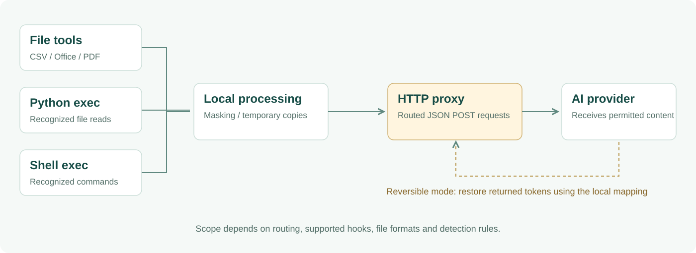

<p align="center"></p>

<p align="center"><strong>English</strong> · <a href="README.zh-CN.md">中文</a></p>

<p align="center"><strong>Detect and transform sensitive content before supported OpenClaw paths send it onward.</strong><br />A local HTTP proxy and tool hooks, with masking and an experimental reversible-token mode.</p>

<p align="center"><a href="#quick-start">Get started</a> · <a href="#how-it-fits-together">Architecture</a> · <a href="#two-processing-modes">Modes</a> · <a href="#current-boundaries">Current boundaries</a></p>

## What it does

Data Guard is an OpenClaw plugin, registered as `data-guard`. It combines four interception layers with pattern-based sensitive-data processing. Typical matches include email addresses, mainland Chinese phone numbers, ID numbers, bank cards, IPv4 addresses and API-key-like strings. Structured files can also be processed using column names.

| Layer | Entry point | Purpose |
| :--- | :--- | :--- |
| HTTP proxy | Provider requests routed through the local proxy | Process JSON POST bodies before forwarding |
| File tools | `read`, `read_file`, `read_many_files` | Substitute processed temporary copies of supported files |
| Python exec | Recognized Python reads in `exec` / `process` | Rewrite supported file-reading operations |
| Shell exec | Recognized shell and language commands | Rewrite supported commands that read files |

This is selective interception, not a system-wide sandbox or a guarantee that every sensitive value will be caught.

## How it fits together



File and execution hooks prepare supported inputs; the HTTP proxy adds a request-level check for traffic routed through it. Reversible response handling uses a local token mapping. These are separate integration points, not four guaranteed passes over every request.

## Quick start

You need an existing OpenClaw installation and its supported Node.js runtime. This package declares Node.js `>=18` and has no external npm dependencies; OpenClaw may require a newer version.

```bash
git clone https://github.com/AlanSong2077/Desensitize-AI-Guard.git
cd Desensitize-AI-Guard
npm pack
openclaw plugins install ./data-guard-2.3.1.tgz
openclaw plugins enable data-guard
openclaw plugins list
```

Use the archive filename printed by `npm pack` if the package version changes. Follow your OpenClaw version's restart or reload instructions after configuration changes. See the [official plugin CLI guide](https://docs.openclaw.ai/cli/plugins).

> Installation starts integration with your gateway. The plugin can rewrite provider base URLs and clean up legacy hooks and stale proxy processes. Back up your OpenClaw configuration and first test with synthetic data. A listed plugin does not prove that requests are being intercepted; inspect proxy logs and exercise the actual provider route.

## Two processing modes

| | Default: `block` | Experimental: `reversible` |
| :--- | :--- | :--- |
| Request handling | With `blockOnFailure=true`, reject detected sensitive content | Replace recognized values with opaque tokens |
| Provider receives | No forwarded body for a blocked request | Permitted text containing tokens |
| Response handling | Normal forwarding for permitted requests | Attempt to restore returned tokens using the same local mapping |

Conceptual example — token IDs vary:

```text
Input:          Contact demo@example.com
Provider text:  Contact <ENC>EMAIL_…</ENC>
Local response: Contact demo@example.com
```

The reversible engine stores AES-256-GCM-encrypted values locally. The text sent to the provider contains token identifiers, not ciphertext. Its reversible patterns cover six categories: email, phone, ID card, bank card, IPv4 and API-key-like strings. Reversible mode does not automatically apply all masking rules.

Restoration needs the original mapping and intact tokens. Restarted processes, rewritten tokens and tokens split across streamed response fragments can prevent restoration. Token substitution also removes information the model may need to perform some tasks.

## Configuration

Merge this under `plugins.entries.data-guard.config` in your OpenClaw configuration:

```json
{
  "port": 47291,
  "blockOnFailure": true,
  "fileGuard": true,
  "pythonGuard": true,
  "shellGuard": true
}
```

For the proxy's reversible mode, the current implementation reads `DATA_GUARD_MODE=reversible` and `DATA_GUARD_ENCRYPTION_PASSWORD` from the gateway process environment. Configure these in the environment that actually launches the gateway; setting a variable on a restart command alone may not reach a service-managed process. Use a private password rather than the built-in fallback.

The manifest exposes `mode`, `encryptionPassword` and `skipPrefix`, but the plugin entry does not forward mode/password to the proxy, and the current proxy has no skip-prefix branch. Do not rely on those config fields alone. `blockOnFailure=false` permits masked content in block mode and may forward original content after processing errors.

## Files and development

Registered handlers include CSV, XLSX/XLSM, XLS, DOCX/DOTX, PPTX/POTX and PDF. Output may be converted to CSV or text rather than preserving the source format. The PDF parser has limited font/layout handling, no OCR, and no encrypted-PDF support.

```bash
npm run test:core
npm run test:formats
```

The complete test suite is `npm test`. Additional scripts are listed in [package.json](package.json).

## Current boundaries

- Detection rules can miss sensitive values or alter harmless text.
- The proxy checks routed JSON POST bodies. Other content types, unparseable JSON, headers and URLs are not comprehensively filtered.
- Unsupported tools, command forms and file contents need separate review; this is not a network firewall.
- Local mappings, temporary files and returned plaintext still require appropriate local access controls.
- Package version is `2.3.1`; the plugin manifest still reports `2.3.0`.
- In the documentation review on 2026-10-13, format tests passed 34/34; core tests had 11 failures. OpenClaw end-to-end coverage and reversible streaming were not validated in that review.

These limits are part of the current implementation. Avoid treating the plugin as an audited, universal data-loss-prevention boundary.

## Contributors and license

Credits retained from the project: Alan Song, Roxy Li, keyuzhang838-dotcom and Ayang77777.

[package.json](package.json) declares MIT. A standalone license file is not currently included in the repository.
