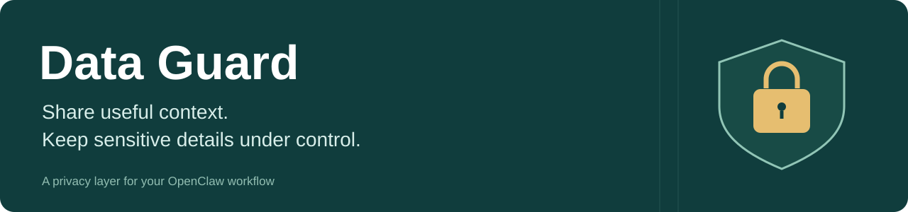
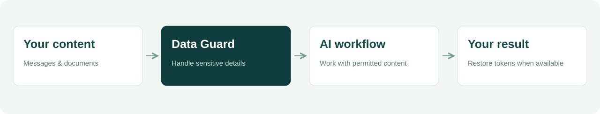

<p align="center"></p>

<p align="center"><strong>English</strong> · <a href="README.zh-CN.md">中文</a></p>

<p align="center"><strong>Use AI with your documents. Reduce unnecessary exposure of sensitive details.</strong><br />Data Guard helps process sensitive content in supported OpenClaw workflows before it reaches an AI provider.</p>

<p align="center"><a href="#why-data-guard">Why Data Guard</a> · <a href="#how-it-works">How it works</a> · <a href="#get-started">Get started</a></p>

## Why Data Guard

A spreadsheet, customer note or business document can contain more information than an AI task needs. Data Guard adds a local processing step, helping you use that content with greater control over sensitive details.

<table>
<tr>
<td width="33%" valign="top"><h3>Work with documents</h3><p>Process supported spreadsheets and Office/PDF content used by your agent.</p></td>
<td width="33%" valign="top"><h3>Choose your approach</h3><p>Stop flagged requests, or experiment with token replacement and local restoration.</p></td>
<td width="33%" valign="top"><h3>Keep your workflow</h3><p>Integrate with supported OpenClaw file tools, execution tools and provider routes.</p></td>
</tr>
</table>

## How it works



### Two ways to handle sensitive content

| Block mode | Reversible mode · experimental |
| :--- | :--- |
| Stop flagged requests before forwarding them. | Replace recognized values with tokens and attempt to restore returned tokens locally. |
| Start here when you want a clear stop on detected sensitive content. | Explore tasks where the original values need to appear in the final result. |

<table>
<tr>
<td width="50%"><strong>Original input</strong><pre>Contact demo@example.com</pre></td>
<td width="50%"><strong>Tokenized text sent onward</strong><pre>Contact &lt;ENC&gt;EMAIL_…&lt;/ENC&gt;</pre></td>
</tr>
</table>

Illustrative reversible-mode example. Restoration requires the original local mapping and intact tokens; not every task or content type is supported.

## Get started

Requires OpenClaw and its supported Node.js runtime. The plugin has no external npm dependencies.

```bash
git clone https://github.com/AlanSong2077/Desensitize-AI-Guard.git
cd Desensitize-AI-Guard
npm pack
openclaw plugins install ./data-guard-2.3.1.tgz
openclaw plugins enable data-guard
openclaw plugins list
```

Use the filename printed by `npm pack` if the version changes. Back up your OpenClaw configuration, then try a synthetic document and check the actual request route before using personal data. Follow your OpenClaw version's reload instructions.

> **Current scope:** Data Guard handles supported tools and requests routed through its proxy. Detection can miss information or alter harmless text. This project is under validation and does not guarantee complete privacy coverage.

## Learn more

[Setup, configuration & current limitations](docs/implementation.md) · [OpenClaw plugin guide](https://docs.openclaw.ai/cli/plugins) · [Report an issue](https://github.com/AlanSong2077/Desensitize-AI-Guard/issues)

<details>
<summary>Development and credits</summary>

Run `npm test` for the test suite. The technical notes include the latest documentation-review results and known integration gaps.

Credits: Alan Song, Roxy Li, keyuzhang838-dotcom and Ayang77777. The package declares MIT; a standalone license file has not yet been included.

</details>
