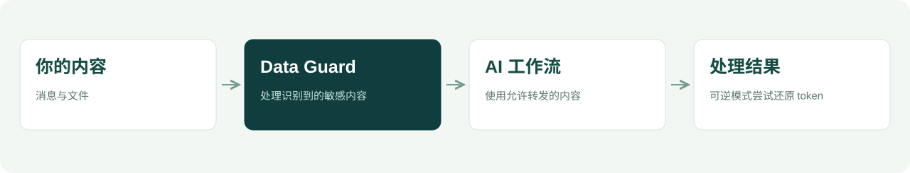

<p align="center"></p>

<p align="center"><a href="README.md">English</a> · <strong>中文</strong></p>

<p align="center"><strong>让 AI 帮你处理文件，减少敏感细节的不必要暴露。</strong><br />Data Guard 在支持的 OpenClaw 工作流中，为内容发送到 AI 服务商前增加一道本地处理。</p>

<p align="center"><a href="#为什么使用-data-guard">项目用途</a> · <a href="#使用流程">使用流程</a> · <a href="#开始使用">开始使用</a></p>

## 为什么使用 Data Guard

一张表格、一份客户记录或一份业务文档，可能包含超出 AI 任务需要的信息。Data Guard 帮你在使用这些内容时，对敏感细节多一层控制。

<table>
<tr>
<td width="33%" valign="top"><h3>处理常用文件</h3><p>面向 Agent 使用的表格、Office 和 PDF 内容，处理支持格式中的敏感信息。</p></td>
<td width="33%" valign="top"><h3>选择处理方式</h3><p>阻断检测到敏感内容的请求，或尝试 token 替换与本地还原。</p></td>
<td width="33%" valign="top"><h3>接入现有工作流</h3><p>与支持的 OpenClaw 文件工具、执行工具和服务商路由配合使用。</p></td>
</tr>
</table>

## 使用流程



### 两种敏感内容处理方式

| 阻断模式 | 可逆模式 · 实验性 |
| :--- | :--- |
| 在转发前停止检测到敏感内容的请求。 | 将识别到的值替换为 token，尝试在本地还原响应中的 token。 |
| 希望发现敏感信息就停止请求时，从这里开始。 | 最终结果需要显示原始值时，可探索这种方式。 |

<table>
<tr>
<td width="50%"><strong>原始输入</strong><pre>Contact demo@example.com</pre></td>
<td width="50%"><strong>替换后发送的文本</strong><pre>Contact &lt;ENC&gt;EMAIL_…&lt;/ENC&gt;</pre></td>
</tr>
</table>

以上为可逆模式示意。还原需要原来的本地映射和完整 token，并非所有任务与内容类型都适用。

## 开始使用

需要安装 OpenClaw，并使用其支持的 Node.js。插件没有外部 npm 依赖。

```bash
git clone https://github.com/AlanSong2077/Desensitize-AI-Guard.git
cd Desensitize-AI-Guard
npm pack
openclaw plugins install ./data-guard-2.3.1.tgz
openclaw plugins enable data-guard
openclaw plugins list
```

版本变化时以 `npm pack` 输出的文件名为准。先备份 OpenClaw 配置，用虚构文件测试，并核对实际请求路由，再使用个人资料。重载方式遵循当前 OpenClaw 版本的说明。

> **当前范围：**处理支持的工具与经过本地代理的请求。识别可能漏检，也可能误改普通内容。项目仍在验证中，不保证覆盖所有隐私数据与使用路径。

## 更多说明

[安装配置与当前限制](docs/implementation.zh-CN.md) · [OpenClaw 插件文档](https://docs.openclaw.ai/cli/plugins) · [反馈问题](https://github.com/AlanSong2077/Desensitize-AI-Guard/issues)

<details>
<summary>开发与贡献者</summary>

测试使用 `npm test`。技术文档保留本次核对的测试结果及已知接入问题。

署名：Alan Song、Roxy Li、keyuzhang838-dotcom、Ayang77777。包声明 MIT，当前尚未包含独立许可证文件。

</details>
