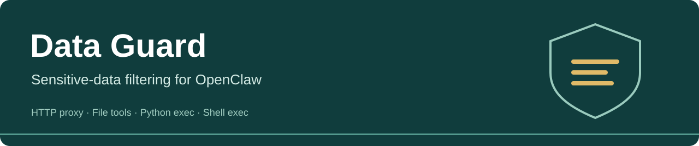
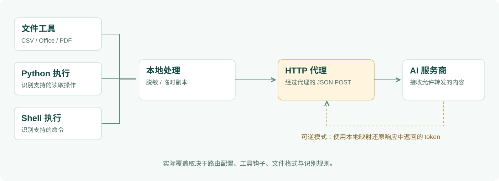

<p align="center"></p>

<p align="center"><a href="implementation.md">English</a> · <strong>中文</strong></p>

<p align="center"><strong>在支持的 OpenClaw 数据路径中，识别并处理敏感内容。</strong><br />结合本地 HTTP 代理与工具钩子，提供脱敏及实验性的可逆 token 模式。</p>

<p align="center"><a href="#快速开始">开始使用</a> · <a href="#架构与流程">架构流程</a> · <a href="#两种处理模式">处理模式</a> · <a href="#当前边界">当前边界</a></p>

## 项目用途

Data Guard 是 OpenClaw 插件，注册 ID 为 `data-guard`。它通过四个拦截层和规则匹配处理敏感内容，常见类型包括邮箱、中国大陆手机号、身份证、银行卡、IPv4 地址及类似 API Key 的字符串。结构化文件还可以根据列名选择脱敏规则。

| 拦截层 | 入口 | 作用 |
| :--- | :--- | :--- |
| HTTP 代理 | 路由到本地代理的服务商请求 | 处理 JSON POST 请求体后再转发 |
| 文件工具 | `read`、`read_file`、`read_many_files` | 用处理后的临时副本替换支持的文件 |
| Python 执行 | `exec` / `process` 中可识别的 Python 读取 | 改写支持的文件读取操作 |
| Shell 执行 | 可识别的 Shell 和语言命令 | 改写支持的文件读取命令 |

这是针对特定路径的拦截，不是系统级沙箱，也不能保证识别所有敏感信息。

## 架构与流程



文件与执行钩子处理支持的输入，HTTP 代理对经过它的请求再进行检查。可逆响应处理依赖本地 token 映射。这些是不同的接入点，不意味着每个请求必定经过四层处理。

## 快速开始

需要先安装 OpenClaw，并使用其支持的 Node.js。插件声明 Node.js `>=18`，无外部 npm 依赖；OpenClaw 本身可能要求更新的版本。

```bash
git clone https://github.com/AlanSong2077/Desensitize-AI-Guard.git
cd Desensitize-AI-Guard
npm pack
openclaw plugins install ./data-guard-2.3.1.tgz
openclaw plugins enable data-guard
openclaw plugins list
```

版本变化时，以 `npm pack` 输出的文件名为准。配置修改后，按当前 OpenClaw 版本的说明重载或重启。参考 [官方插件 CLI 文档](https://docs.openclaw.ai/cli/plugins)。

> 插件接入网关时会改写服务商 base URL，并清理旧版钩子和残留代理进程。先备份 OpenClaw 配置，用虚构数据验证。插件出现在列表中不等于请求已受保护，还需检查代理日志并测试实际服务商路由。

## 两种处理模式

| | 默认：`block` | 实验性：`reversible` |
| :--- | :--- | :--- |
| 请求处理 | `blockOnFailure=true` 时，拒绝检测到敏感内容的请求 | 将识别到的值替换为不透明 token |
| 服务商收到 | 被阻断的请求不转发 | 允许转发的文本及 token |
| 响应处理 | 正常转发允许请求的响应 | 使用同一份本地映射尝试还原返回的 token |

示意如下，实际 token ID 会变化：

```text
原始输入：   Contact demo@example.com
服务商文本： Contact <ENC>EMAIL_…</ENC>
本地响应：   Contact demo@example.com
```

可逆引擎在本地用 AES-256-GCM 保存加密值；发送给服务商的是 token 标识，不是密文本身。可逆规则包含六类：邮箱、手机号、身份证、银行卡、IPv4 和 API Key 类字符串，不会自动覆盖全部脱敏规则。

还原需要原映射和完整 token。进程重启、模型改写 token、流式响应将 token 拆到多个片段，都可能导致无法还原。替换敏感内容也可能影响模型完成某些任务所需的信息。

## 配置

将以下字段合并到 OpenClaw 配置中的 `plugins.entries.data-guard.config`：

```json
{
  "port": 47291,
  "blockOnFailure": true,
  "fileGuard": true,
  "pythonGuard": true,
  "shellGuard": true
}
```

当前代理的可逆模式读取网关进程环境中的 `DATA_GUARD_MODE=reversible` 和 `DATA_GUARD_ENCRYPTION_PASSWORD`。应配置到真正启动网关的环境里；只在重启命令前设置变量，不一定能传给系统服务。密码应使用私有值，不要依赖内置默认值。

清单虽然声明了 `mode`、`encryptionPassword` 和 `skipPrefix`，但入口没有向代理传递 mode/password，当前代理也没有 skip-prefix 分支，不能只靠这些配置字段判断已生效。`blockOnFailure=false` 会允许 block 模式的脱敏内容通过，处理异常时还可能透传原文。

## 文件与开发

已注册 CSV、XLSX/XLSM、XLS、DOCX/DOTX、PPTX/POTX 和 PDF 处理器。输出可能转换为 CSV 或文本，不保证保留原文件格式。PDF 的字体与布局支持有限，不支持 OCR 或加密 PDF。

```bash
npm run test:core
npm run test:formats
```

完整测试使用 `npm test`，其他脚本见 [package.json](../package.json)。

## 当前边界

- 规则识别可能漏检敏感内容，也可能误改普通文本。
- 代理处理经过它的 JSON POST 请求体，不全面过滤其他类型、解析失败的 JSON、请求头或 URL。
- 不支持的工具、命令写法和文件内容需单独检查；它不是网络防火墙。
- 本地映射、临时文件和还原后的明文仍需要妥善控制访问。
- npm 包版本为 `2.3.1`，插件清单仍标为 `2.3.0`。
- 2026-10-13 文档核对中，格式测试 34/34 通过，核心测试有 11 项失败；未验证 OpenClaw 完整接入及可逆流式响应的端到端覆盖。

这些是当前实现的实际边界，不应将其视为经过审计、覆盖所有数据路径的防泄漏方案。

## 贡献者与许可

保留项目原有署名：Alan Song、Roxy Li、keyuzhang838-dotcom、Ayang77777。

[package.json](../package.json) 声明 MIT，仓库当前未包含独立的许可证文件。
